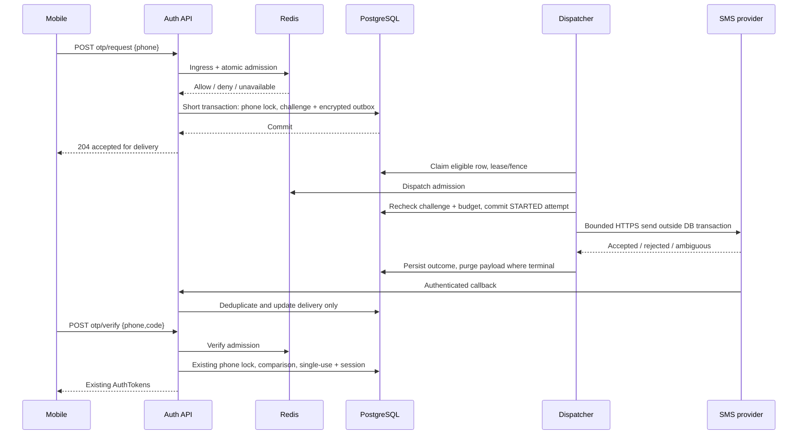

# ADR P1.6 — production SMS OTP architecture

Date: 2026-10-27. Revision: **R2 — principles conditionally accepted; implementation NOT authorized**.

This is a design, not a claim of implemented Redis/outbox/SMS behavior. MSG91 is the provisional primary candidate; Twilio is an alternative requiring its own commercial and technical approval. No code, migration, configuration, credentials or services changed for this ADR.

## 1. Baseline and preserved contracts

Inspected `AuthService`, `AuthController`, `OtpChallenge`, `OtpChallengeRepository`, `OtpProvider`, `ProductionOtpProvider`, `DevelopmentOtpProvider`, `application.yml` and migration files V1–V13. V4 creates challenges and `(phone, created_at DESC)` index; V5 adds phone/attempt/expiry constraints, timestamp trigger and secure session families. There is no delivery outbox or Redis configuration in this baseline.

Keep these external contracts:

| Endpoint | Input | Success | Preserved behavior |
|---|---|---|---|
| POST /api/v1/auth/otp/request | `{phone}` | 204, no code/token | Admission and durable enqueue acknowledgement; not a handset-delivery guarantee |
| POST /api/v1/auth/otp/verify | `{phone, code}` | Existing AuthTokens | Existing user creation, account checks, single-use verification and token issuance |
| POST /api/v1/auth/refresh | `{refreshToken}` | Existing AuthTokens | Unchanged rotation/family replay protection |
| POST /api/v1/auth/logout | `{refreshToken}` | 204 | Unchanged server-session revocation |

Continue 400 for invalid inputs/codes, 429 for limits, 503 for unavailable infrastructure/provider readiness. Additive `Retry-After` header on 429 is allowed; clients need not change bodies. Do not return provider credentials, message IDs, challenge IDs, whether a phone is registered, or callback details. Before accepting requests, provider configuration and circuit state must be ready; the default unconfigured production behavior remains 503.

OTP remains SecureRandom six digits, BCrypt hash, five-minute lifetime from challenge creation, maximum three comparisons per challenge. Latest challenge wins; verified/expired/superseded/locked challenges cannot authenticate. Preserve current phone API syntax; proposed initial production delivery policy is Indian mobile `+91[6-9][0-9]{9}` only, subject to approval. It is syntax and destination policy, not proof of allocation. Do not rewrite existing phone records or change mobile normalization silently.

JWT algorithm/issuer/access lifetime, 30-day session lifetime, refresh hashing/reuse rules and authorization remain untouched. SMS delivery receipts never grant a session or change roles.

## 2. Proposed components and ownership

- **OtpAdmissionFilter:** small request/body limits, trusted-client-IP resolution, cheap ingress limiter before BCrypt/database work. No body/code logging.
- **OtpRateLimiter:** shared Redis admission reservations, atomic multi-key evaluation, explicit deny/unavailable outcomes.
- **OtpApplicationService:** existing auth behavior refactored internally into short challenge/enqueue and verification transactions. No outbound HTTP inside a database transaction.
- **OtpDeliveryCoordinator:** production strategy creates encrypted delivery intent in the same PostgreSQL transaction as the challenge. Dev strategy retains isolated existing development workflow; never invokes a real adapter.
- **OtpOutboxDispatcher:** claim, authorize dispatch, decrypt briefly, call transport, persist outcome. Runs inside backend instances initially with bounded workers; no new broker required.
- **SmsDeliveryAdapter:** provider-specific payload conversion and result classification, no OTP verification/token issuance.
- **SmsCallbackController/Verifier:** provider-specific authentication and bounded parsing; durable idempotent delivery updates.
- **OtpRetentionJob / OtpMetrics:** payload destruction, metadata cleanup, aggregate operational alerts.

Existing `OtpProvider.sendOtp(phone, code)` cannot identify a durable challenge or represent ambiguous outcomes. Keep its verification behavior and development implementation; introduce the delivery coordinator at the internal requestOtp call site rather than a hidden thread-local or a second independent OTP service. Production delivery no longer calls this void transport method. Public controllers and token contracts stay unchanged.

## 3. Exact proposed launch limits

All values below are initial **approval candidates**, not activated settings. Rolling windows avoid fixed-window boundary bursts. National carrier NATs require load testing; raising an IP limit must not weaken phone/global limits.

| Operation | Dimension | Limit |
|---|---|---|
| Request ingress (includes malformed/rejected calls) | IP | 60 per rolling minute |
| Verify ingress (includes malformed/rejected calls) | IP | 120 per rolling minute |
| All OTP ingress | Global | 1,200 per rolling minute |
| New challenge admission, including resends | Phone | 1 per rolling 60 seconds; 3/15 minutes; 6/hour; 10/24 hours |
| New challenge admission | IP | 20/5 minutes; 100/hour; 500/24 hours |
| New challenge admission | Global | 100/minute; 1,000/hour; 5,000/24 hours |
| Verify admission, valid-shaped phone/code | Phone | 10/15 minutes; 30/hour |
| Verify admission | IP | 60/5 minutes; 300/hour |
| Verify admission | Global | 600/minute |
| Credential comparison | Challenge (PostgreSQL) | 3 total, persisted across all instances |
| Actual transport attempts (including retries) | Global | 100/minute; 1,000/hour; 5,000/24 hours |
| Optional device request signal | Device | 5/15 minutes; 20/24 hours, only when supported |

All request calls are initial request or resend; no separate unlimited resend endpoint. At most ten new challenges per phone per rolling day, not ten retries per challenge. Rejected operations do not consume challenge attempt counts, but still consume ingress capacity. A valid-format wrong OTP consumes one of the three challenge attempts inside the existing non-rollback security transaction. Expired/used codes never reach comparison.

Redis challenge admission counts remain consumed even if PostgreSQL later fails: no distributed rollback/refund that an attacker could exploit. Successful verification does not reset phone/IP send limits. No permanent phone/account lock; retry becomes available when the limiting window expires, mitigating attacker-triggered permanent lockouts. Limits still permit temporary victim denial and need alerting/support.

Device identity is currently absent; optional additive header support may be introduced later. A resettable client identifier is a weak risk signal, never a substitute for phone/IP/global limits. Missing device ID does not break existing clients. Production request/verify limits apply across every backend instance using the same shared Redis state.

## 4. Redis key, atomicity and failure design

### Keys and privacy

Example key shape (no raw phone/IP):

```text
labourly:otp:{otp-prod}:v1:req:phone:<HMAC-SHA256(canonicalPhone)>:15m
labourly:otp:{otp-prod}:v1:req:ip:<HMAC-SHA256(canonicalIp)>:5m
labourly:otp:{otp-prod}:v1:req:global:1m
labourly:otp:{otp-prod}:v1:verify:phone:<digest>:15m
labourly:otp:{otp-prod}:v1:dispatch:global:24h
labourly:otp:{otp-prod}:v1:op:<gate>:<internalOperationUUID>
labourly:otp:{otp-prod}:v1:ready
```

Separate environment namespaces, ACL users and credentials. Domain-separate HMAC inputs (`phone:`, `ip:`, `device:`) using a server-only key unrelated to JWT/encryption/provider keys. These are pseudonymous identifiers, not anonymous data. IPv4-mapped IPv6 must canonicalize consistently. Resolve client IP from the socket unless the direct peer is an explicitly trusted proxy; strip/overwrite inbound forwarded headers at ingress. Do not trust arbitrary X-Forwarded-For. Define IPv6 /64 aggregation as a separate review item before enabling it; initial limits use canonical full IP.

All OTP limiter keys use the same Redis Cluster hash tag `{otp-prod}`, so multi-dimension Lua execution remains atomic. This intentionally concentrates OTP limiter traffic on one shard; it is acceptable only for the proposed launch ceilings and must be benchmarked. Do not claim linear cluster scalability or shard a global quota without redesign. Redis documents atomic scripts and same-slot multi-key requirements. [Redis INCR/rate-limit patterns](https://redis.io/docs/latest/commands/incr/), [Redis limiter examples](https://redis.io/tutorials/howtos/ratelimiting/).

### Algorithm

Use one sorted set per dimension/window; member is a server-generated operation UUID and score is Redis server time in milliseconds. Lua receives explicitly declared KEYS, configured caps/windows and operation ID; no user-controlled key names.

1. Check readiness/generation and operation result cache. For an internal retry of the same operation, return the cached decision without charging twice.
2. Read Redis TIME. Prune scores `<= now - window` for each supplied key.
3. Check all caps before inserting any entries. On denial return maximum time until a slot becomes available across violated windows, rounded up to seconds (minimum 1). Do not insert into any admission set.
4. If all allow, insert the same operation member in every dimension/window and set each key TTL to window + 60 seconds. TTL is renewed only on insertion. Denied traffic must not extend window keys indefinitely.
5. Cache allow/deny outcome for 60 seconds using the same Lua operation. This covers Redis transport retries, not public request idempotency. Retry with the same internal UUID, never a new one after an ambiguous Redis response.

Ingress is evaluated first; valid requests then evaluate the challenge/verify limiter. Each gate (request-ingress, verify-ingress, challenge, verify, dispatch) has a distinct operation-cache namespace: an ingress allow must never be mistaken for admission at a later gate. This deliberately charges ingress even if the second gate denies. The caller returns 503 if Redis result cannot be determined within a proposed 200ms total deadline; no database/enqueue/provider work then occurs. No process-local fallback.

### Durability, failover and recovery

Redis uses authenticated TLS, private network, dedicated no-eviction capacity, persistence and monitored replication. These reduce loss but do not make acknowledged writes immune to asynchronous failover. On unavailable, eviction, flush, unexpected generation change or known failover loss: request/verify admission and new dispatch **fail closed**; existing JWT/refresh/logout endpoints remain independent of this limiter and continue under existing security controls. Webhooks may still persist to PostgreSQL.

The readiness key is never recreated automatically by request handlers. Redis reinitialization requires an operator-approved recovery. Reconstruct durable phone request and dispatch history from PostgreSQL (retained at least 48h); IP/ingress/verification budgets cannot be completely reconstructed from current schema. For lost counters, preserve a conservative no-new-OTP interval of up to 24h (maximum active quota window) or approve a controlled restricted recovery policy. This availability cost is explicit; do not silently reset quotas after restart.

HMAC rotation must not reset limits: dual-read/charge old and new key derivations for a 24h overlap, then retire old keys. Rate limit threshold changes retain the same window keys. Raising limits is an audited configuration action. Alert at 70%/90% quotas and on limiter/storage errors; never log key inputs.

## 5. PostgreSQL schema proposal — no migration created

At inspection V13 is latest. Reserve **V14__otp_delivery_outbox.sql** only if still the next unused version at implementation. Never modify V1–V13. No booking/user/refresh historical rows are rewritten.

### Existing otp_challenges: two nullable columns

- `invalidated_at timestamptz NULL`
- `invalidation_reason varchar(24) NULL`, allowed `SUPERSEDED`, `DELIVERY_REJECTED`; check both null or both non-null.

Existing `verified`, `attempts`, `max_attempts`, `expires_at` and hash remain authoritative. Derived states: VERIFIED; INVALIDATED(reason); EXPIRED; LOCKED (attempts >= max); ACTIVE. Expiry is time-derived, not dependent on a cleanup job. Historical rows need no backfill; current latest-challenge logic remains a second safeguard.

### otp_sms_outbox (one delivery intent per challenge)

| Column | Type / constraint |
|---|---|
| id | UUID PK, stable delivery ID |
| challenge_id | UUID NOT NULL UNIQUE FK otp_challenges, restrict deletion until retained delivery children are purged |
| provider | varchar(16), MSG91 or TWILIO; fixed at enqueue |
| template_key / template_version | bounded strings, immutable approved configuration references |
| state | PENDING, CLAIMED, SENDING, RETRY_WAIT, ACCEPTED, DELIVERED, FAILED, UNKNOWN, EXPIRED, CANCELLED |
| payload_ciphertext / payload_nonce / key_id | nullable bytea/bytea/bounded string; present for sendable states, purged after acceptance/final state/expiry; GCM authentication tag included in ciphertext |
| expires_at / available_at | timestamptz NOT NULL; expiry copied from challenge, never extended by retry |
| lease_owner / lease_until | nullable bounded identifier / timestamptz |
| fence | bigint NOT NULL default 0; increment on each claim |
| attempt_count | smallint NOT NULL default 0, CHECK 0..3 |
| last_error_code | bounded enum/code, never raw provider response |
| request_key_hash | nullable bytea; HMAC of optional public idempotency key plus canonical phone + endpoint |
| created_at / updated_at | timestamptz; use existing touch_updated_at function |

Unique partial index on request_key_hash when not null; partial polling index `(available_at,id)` on PENDING/RETRY_WAIT; lease sweep index `(lease_until,id)` on CLAIMED/SENDING. Query active requests by existing phone index through challenge join. Restrict updates to immutable IDs/provider/template/expiry in application repository methods; test invariants.

### otp_sms_attempts (durable dispatch accounting)

`id UUID PK`, `outbox_id UUID NOT NULL FK`, `attempt_no smallint 1..3`, `fence bigint`, `state` (STARTED, ACCEPTED, DEFINITELY_NOT_SENT, REJECTED, UNKNOWN, DELIVERED, UNDELIVERED), `provider`, nullable `provider_message_id`, `started_at`, nullable `completed_at`, safe `error_code`.

UNIQUE(outbox_id, attempt_no), UNIQUE(provider, provider_message_id) WHERE message ID not null; index started_at for rolling dispatch totals. Every potential network send must have a committed STARTED row first. Count all STARTED attempts conservatively, even if process fails before I/O. Under one short global PostgreSQL advisory budget lock, enforce the same 100/min, 1,000/hour, 5,000/24h dispatch caps using retained attempts. This provides durable spend-count protection even if Redis counters lose writes. It caps attempts, not currency; a provider-side monetary cap and single-segment template are still required.

### otp_sms_callback_events (minimal deduplication/inbox)

`id UUID PK`, `provider`, `dedupe_hash bytea NOT NULL`, `provider_message_id` bounded, nullable `attempt_id FK`, normalized `status`, nullable `provider_occurred_at`, `received_at`, nullable `processed_at`, `authentication_mode` (SIGNATURE, SECRET_HEADER, API_RECONCILED). UNIQUE(provider,dedupe_hash). No raw body, phone, OTP or secret. Index unresolved events by message ID and age. Keep authenticated callbacks that precede the send response for bounded reconciliation rather than losing them.

These three new tables support dispatch ownership/accounting, receipt-before-response races and durable deduplication. A single outbox row without attempts/inbox cannot safely account for ambiguous retries or callback races. No new challenge-status table or change to JWT/session tables is needed.

## 6. Request, verify and dispatch sequence



### Request transaction

After ingress/validation, optional public idempotency lookup (under ingress protection) may return the prior committed acknowledgement without new phone quota. Optional `Idempotency-Key` header: versioned timestamp plus random UUID, no required change for clients that omit it; store HMAC scoped to phone/endpoint, dedupe retained at least 48h; header keys carry a bounded creation timestamp as specified in section 16.3. Replay is state-aware as specified in section 16.3: only a still-usable challenge can receive 204; terminal/unusable requests return the existing 400 error shape without disclosing the specific terminal reason. New user resend needs a new key. No header means normal 60-second cooldown, not transparent network retry idempotency. Concurrent duplicates consume at most conservative admission capacity but database uniqueness ensures one challenge/outbox. No credentials are returned on a request replay.

After admission, acquire the existing phone advisory lock. Enforce latest DB-created timestamp cooldown again, plus durable 3/15m, 6/h, 10/24h counts from challenge rows (existing index). Invalidate previous unverified active challenge as SUPERSEDED and cancel its unsent jobs. Generate/hash the new code, encrypt its delivery payload and insert challenge/outbox atomically. Enqueue no notification containing OTP. Do not refund Redis admission if commit fails. Use DB/current UTC consistently and test boundaries; latest selection is deterministic by created_at and id.

Queued requests can fail later, so existing mobile “code sent” text is a UX follow-up: recommend “Code requested; delivery may take a moment”, without changing the API body. This ADR does not modify that UI.

### Verify transaction

Apply verify gates, then retain existing phone lock and latest-challenge checks plus invalidation check. Do not require a DELIVERED receipt: a user can receive SMS before the callback, and callbacks can be missing. A valid code for the current unexpired challenge can authenticate even while delivery state is UNKNOWN. Increment comparison attempt persistently; success remains single-use and issues existing tokens. Cancel pending delivery on success. Never extend code expiry from callback or retry.

### Dispatcher ownership

Poll every 1s, batch at most 20; initial max four concurrent provider calls per instance with global Redis/DB limits. Claim with `FOR UPDATE SKIP LOCKED`, set CLAIMED with 30s lease and increment fence; commit immediately. No provider I/O under row/advisory locks.

Before sending: get Redis dispatch admission; under consistent lock order (phone advisory, global dispatch-budget advisory, outbox row), recheck fence, lease, current/unverified/unlocked/unexpired challenge and at least 15s remaining; reserve durable attempt and mark SENDING, commit. Decrypt only after dispatch authorization. Connect timeout 2s, total HTTP deadline 5s; disable automatic POST retries and cross-host redirects. Process outcomes with attempt identity/fence; old workers cannot overwrite a newer row state.

A CLAIMED lease may be reclaimed only if no STARTED attempt exists. An expired SENDING lease becomes UNKNOWN, never automatically PENDING. A paused worker may still send after its last DB check; fencing cannot cancel already-authorized network I/O. Do not promise exactly-once SMS. The conservative rule prevents a second worker from blindly resending; superseded/expired codes remain unverifiable even if a late SMS arrives.

## 7. Delivery state, retries and ambiguity

| Event | Transition / action |
|---|---|
| Committed request | PENDING |
| Claimed with lease | PENDING/RETRY_WAIT → CLAIMED |
| Attempt committed | CLAIMED → SENDING |
| Provider confirms acceptance with ID | SENDING → ACCEPTED; destroy encrypted code payload |
| Authenticated delivered receipt | ACCEPTED/UNKNOWN → DELIVERED; receipt may resolve UNKNOWN |
| Explicit permanent rejection (invalid template/destination/auth) | SENDING → FAILED; invalidate current challenge DELIVERY_REJECTED; open relevant circuit |
| Proven not accepted, transient condition | SENDING → RETRY_WAIT, if budget/expiry/attempt limit allows |
| Timeout after possible request transmission, reset, unparseable success, worker crash after STARTED | SENDING → UNKNOWN; quarantine from automatic resend |
| Deadline or <15s validity remaining before send | Unsent state → EXPIRED; destroy payload |
| New challenge or successful verification before send | Unsent state → CANCELLED; destroy payload |
| Terminal carrier undelivered after acceptance | ACCEPTED → FAILED; no automatic resend; later user resend follows normal limits |

Maximum three transport attempts per delivery intent. Only definitely-not-accepted transient outcomes qualify; suggested backoff 5s then 20s plus 0–2s jitter, capped by remaining lifetime. Even HTTP 429/5xx is not classified “definitely not sent” without the provider's documented semantics. Generic ambiguous outcomes default UNKNOWN.

UNKNOWN reconciliation at 5s, 20s and 60s, then await callback until expiry. Query by provider message ID or supported correlation lookup. If no reliable lookup/idempotency exists, remain UNKNOWN and do not resend. At expiry destroy ciphertext regardless of unresolved status; metadata may later record a receipt but must never reactivate the challenge. Lookup failures are not permission to fail over.

Stable delivery ID is sent as provider correlation metadata when supported. Correlation is **not** provider idempotency. Adapter capability declaration must default idempotentSend=false until documented/contract-tested. Retries use the same logical delivery ID and distinct attempt numbers. No automatic MSG91→Twilio fallback in phase one. A provider switch affects only new jobs after approval; existing UNKNOWN jobs stay bound to their original provider.

### State reconciliation details

UNKNOWN jobs are never redispatched automatically, even when a later lookup says absent; any exception needs a separately reviewed provider guarantee. At expiry, retain UNKNOWN as the historical delivery outcome and purge ciphertext; challenge expiry independently blocks verification. ACCEPTED jobs similarly remain eligible for late receipt reconciliation after OTP expiry, without becoming sendable. EXPIRED applies to unsent jobs only. A delayed send result must update its attempt record even if the job fence changed; reconciliation may then update the job under a fresh row lock without reviving cancelled/expired work. Permanent rejection invalidation must occur under the phone lock and must not overwrite a challenge already verified in a racing transaction.

Dispatch budget history is retained for at least 48 hours from attempt start; pruning must not remove any record in the rolling 24-hour budget. Callback tombstones outlive attempt rows, so the attempt FK must permit explicit nulling before purge. Cached operation decisions expire after 60 seconds; internal retry after that deadline is prohibited and must return unavailable rather than risking a second reservation.

## 8. Adapter contracts

Proposed internal types (design notation only):

```text
DeliveryCommand(deliveryId, attemptId, canonicalPhone, otp,
                templateKey, templateVersion, expiresAt)
SendOutcome = Accepted(providerMessageId)
            | DefinitelyNotSent(retryable, safeCode)
            | Rejected(safeCode)
            | Unknown(optionalMessageId, safeCode)
LookupOutcome = Pending | Delivered | Undelivered | DefinitivelyAbsent | Unknown
SmsAdapter.send(command) -> SendOutcome
SmsAdapter.lookup(providerMessageId/correlationId) -> LookupOutcome
SmsAdapter.authenticateAndParseCallback(rawBytes, headers, externalUrl)
  -> VerifiedDeliveryEvent(providerMessageId, eventId?, status, occurredAt?)
```

MSG91 adapter: map canonical +91 phone to documented SMS API destination format only at boundary; approved sender/PE/template fields from server configuration; OTP as template variable. Prefer SMS transport of Labourly-generated codes, not a provider OTP widget/verification API. Validate API response schema/status and bounded message ID. Exact endpoint/version/acceptance/lookup semantics must be verified against selected product before coding; no guessed endpoints in implementation.

Twilio adapter: Programmable Messaging sender/service and approved India route/template; Labourly retains verification. Map Message SID and status; use supported official signature validation for callbacks. Do not substitute Twilio Verify or switch JWT behavior. Both adapters prohibit logging command.toString/raw payloads and pass safe normalized error categories only.

## 9. Callback authentication, replay and secret handling

Dedicated callbacks are additive internal/provider endpoints, not changes to auth contracts. Body maximum 16KB, allowlisted content types, request timeout, throttling and no raw request logging. Respond 2xx only after durable inbox insert; DB unavailable → retryable non-2xx. Authentication failures → 403. Unrecognized message ID cannot touch an account/challenge; keep authenticated orphan event up to 24h for matching.

Twilio: validate X-Twilio-Signature using its supported validator, exact externally configured HTTPS URL and complete parameter/raw-body treatment required by content type. Trust forwarded URL reconstruction only from approved proxies. Signature validity alone is not freshness; persist dedupe based on event ID if available or canonical provider/message/status/time hash. Do not assume every webhook has a signed timestamp. [Twilio webhook security](https://www.twilio.com/docs/usage/webhooks/webhooks-security).

MSG91: reviewed documentation supports configurable callback headers, but does not establish a signed per-payload scheme. A high-entropy dedicated secret header over HTTPS is a minimum candidate, not equivalent to a timestamped signature. Require authenticated API reconciliation before authoritative updates when signed authenticity cannot be established; if lookup is unavailable, retain receipt as untrusted telemetry only. Provider callbacks never influence login verification even when authenticated. Confirm support before integration. [MSG91 delivery webhooks](https://msg91.com/help/webhook-new/how-to-receive-sms-delivery-reports-via-webhook-new).

Ignore duplicate terminal events. Never regress DELIVERED to PENDING or make an expired challenge active. For conflicting authenticated terminal receipts, record conflict and reconcile rather than guess arrival order. Event ID fallback hashes include canonical fields, not raw ordering/irrelevant provider parameters. Retain dedupe tombstones through the supported retry horizon; reject unmatched ancient events after metadata deletion.

Use separate server secrets for provider API, callback, HMAC quota identity, delivery encryption and JWT. AES-256-GCM payload encryption with random 96-bit nonce per job; authenticate delivery/challenge/provider/template/expiry as AAD. Key ID supports rotation; key available only to enqueue/dispatcher identities, never mobile. Plaintext code exists only briefly in memory; do not claim guaranteed JVM zeroization. Never persist plaintext in jobs, logs, exceptions or metrics. Secrets injected through secret manager or protected environment; fail startup/readiness if production delivery enabled without valid mapping/keys. Disable dumps/raw HTTP wire logging in production policy.

## 10. Retention and operational controls (proposed)

- Encrypted code: erase on acceptance/final outcome, otherwise at challenge expiry; cleanup every 60s. Backups may retain ciphertext until backup expiry; separate key lifecycle and backup policy are mandatory.
- OTP hashes/challenge phone rows: retain 48h after expiry for rolling budgets/investigation, then delete once dependent delivery rows are purged/anonymized. No touch to user phone records.
- Outbox/attempt metadata: 48h detailed retention; purge children before challenge. Retain aggregate operational counts without phone identifiers for 30 days. If provider dispute/accounting needs longer detail, approve a minimized separate policy before rollout.
- Callback dedupe metadata: seven days; detach nullable attempt FK before attempt purge. Orphans 24h. No raw callback body/phone retained.
- Redis: window+60s TTL; operation cache 60s; no identifier-bearing metrics labels.
- Security logs: 30 days, restricted access, internal request ID, provider, safe outcome, duration and rate-limit dimension only. No phone/code/token/body/signature/auth header; no raw Redis keys.
- Alerts: queue age >30s, oldest job >60s, unknown >1% or ≥5/5min, permanent template/auth rejection on first event, provider error >20% over ≥20 attempts/60s, quota 70%/90%, callback-auth spikes and cleanup lag >2min. Proposed circuit: open 60s on threshold, one globally admitted half-open probe using a real queued job (not fabricated SMS), reopen on failure. Hard configuration errors require operator resolution.

## 11. Indian DLT and commercial approval gate

Required operational checklist: legal principal entity registration; approved sender/header; login-service content template and exact fixed text/variables; applicable consent/use-case classification; validated PE–telemarketer chain for selected route; mapping PE/header/template IDs in provider account; authorised representative/documentation; written pricing/failed-send/segment/tax terms and spend caps; retention/processor/security terms; approved callback endpoint and carrier acceptance plan.

Do not assume all OTPs qualify as banking-style “transactional” messages. Labourly login likely needs a service category, but final categorization must be confirmed by the operator/provider for its actual use case. Do not treat draft regulatory consultations as enacted rules. TRAI describes sender registration, headers/templates and identifiers; MSG91 documents PE–TM chain setup and DLT failure categories. [TRAI sender guidance](https://www.trai.gov.in/advice-to-senders), [MSG91 DLT process](https://msg91.com/help/dlt-registration-in-india/dlt-process/), [MSG91 DLT failures](https://msg91.com/help/delivery-report/dlt-related-failure-reasons).

Candidate text for registration review: “Your Labourly login code is {code}. Valid for 5 minutes. Do not share this code.” This is not an approved template. Keep marketing out; fit one segment and approve each language template separately. Commercial and carrier reliability verification is pending; provider choice remains provisional. No registration/SMS is authorized by this ADR.

## 12. Failure matrix

| Failure | Required outcome |
|---|---|
| Redis down/unknown quota result | 503, no new challenge or send; do not disable existing JWT/refresh/logout |
| DB transaction rollback after Redis allow | No SMS/outbox; quota stays consumed conservatively |
| Commit succeeds, client loses 204 | Optional idempotency header replays acknowledgement; otherwise ordinary cooldown applies |
| Dispatcher crashes before STARTED | Lease-safe reclaim after checking no committed attempt |
| Crash after STARTED/before known result | UNKNOWN, not blind resend |
| Provider accepts, DB result write fails | Durable STARTED remains; callback/lookup reconciliation, no automatic resend |
| Callback arrives before HTTP response | Authenticated inbox event stored; match on provider message ID when available |
| Resend races with outbound I/O | Old code may arrive but cannot verify; newer challenge remains authoritative |
| Provider outage | Circuit/backlog deadlines; no fake success or development fallback |
| Redis loses acknowledged quota writes | Gate closure/recovery; DB phone/dispatch budgets still enforce durable ceilings |
| Callback replay/forgery | Reject unauthenticated; dedupe authenticated; never issue tokens |
| Encryption key missing | Fail readiness/new sends; no plaintext fallback |
| Development profile accidentally mixed with production | No development provider or bypass, production guard tests mandatory |

## 13. Implementation phases and approval boundaries

1. **Approve this ADR:** numerical limits/NAT impact, India-only delivery, Redis topology/recovery availability cost, encryption/retention and provisional provider decision.
2. **Provider-independent implementation:** additive migration, coordinator/outbox/state repositories, encryption abstraction, Redis scripts and test fakes. Real adapters disabled; no existing environment migrations without approval.
3. **Isolated integration gate:** approved disposable Redis/PostgreSQL, migration/backfill/rollback compatibility, concurrency/crash tests. Never use protected development records for destructive testing.
4. **Adapter contract gate:** MSG91/Twilio fake HTTP contract fixtures, signed/secret callback tests and documented idempotency classification; no real SMS.
5. **Operational gate:** provider/DLT commercial approval, secret provisioning, trusted ingress, monitoring, backup/retention, rollback runbook and security review.
6. **Controlled activation:** approved consenting test numbers/carriers and cost cap, then capped canary. Production delivery remains disabled until explicit release approval.

Migration rollout: nullable challenge columns and new tables are additive, but old application versions do not honor invalidation/outbox logic. Pause OTP admission/dispatch, drain old auth instances, apply migration, deploy all new auth nodes, validate, then enable. Existing JWT sessions/marketplace need not be reset. Do not run mixed old/new OTP writers or roll back to old synchronous sender against active jobs. Rollback disables new OTP delivery and pauses workers; retain jobs/evidence, continue existing session endpoints, reconcile UNKNOWN before any restart. New-node readiness requires matching schema/policy generation.

## 14. Test plan and acceptance gates

**Unit (no services):** rate policy validation; canonicalization/trusted-IP parsing; encryption/AAD/tamper/key rotation; adapter outcome mappings including malformed 200; state transition legality; limits/boundaries; expiry clock; redaction; profile matrix default/dev/prod/production/test combinations; no fixed-code bypass outside dev; provider-disabled 503; unchanged JWT/refresh tests.

**Redis integration (approval required):** exact 60s/15m/hour/day edges; concurrent requests across three API instances cannot exceed caps; all-or-none multi-key inserts; dedup same internal UUID; denied calls do not renew TTL; same-slot cluster execution; timeout before/after Lua execution; connection loss, restart, eviction and failover gate behavior; HMAC overlap; memory bound/load/NAT fairness.

**PostgreSQL integration:** V1–next migration from baseline with history untouched; cooldown/rolling budgets; atomic challenge+job commit/rollback; wrong attempts persist, two correct concurrent verifications yield one winner; newest challenge wins; two enqueue retries yield one row; multiple workers SKIP LOCKED; fence/lease behavior; global dispatch budget concurrent ceiling; cleanup FK ordering; existing auth/booking/quotation regression.

**Failure injection:** pause/crash at every boundary around Redis reservation, commit, claim, STARTED, provider I/O, acceptance persistence; callback-before-response; forged/replayed/reordered/conflicting callbacks; provider timeout after accepted send; missing lookup; key unavailable; expiry while queued; resend during dispatch; stale worker resumed after lease; provider rejected template; global cap during retries. Assert no SMS is initiated for rolled-back work, no automatic second send on UNKNOWN, no revived old code and no token issuance from callbacks. Do not assert exactly-once handset delivery.

**Contract/mobile regression:** unchanged request/verify/refresh/logout schemas and status shapes; optional idempotency header; generic errors and Retry-After; queue-delay UX; expired/offline/resend state; 160-test mobile baseline is historical, not rerun for this documentation task.

**Later live gate:** signed-off DLT/route/template, real carrier delivery p50/p95 and failure rates, privacy review, authenticated callbacks, daily spend limit, canary pause/recovery, no OTP/phone/secrets in logs. No live reliability result is claimed now.

## 15. Decisions needing approval (see R2 matrix in section 16.7)

Approve or revise: exact limit table; India-only production destination policy; Redis single-slot launch topology and fail-closed recovery downtime; PostgreSQL additions/V14 availability; encrypted outbox and key/backup retention; optional idempotency header; callback trust policy where provider signatures are unavailable; no automatic provider fallback; initial timeout/circuit/worker parameters; full auth-writer rollout/drain procedure; separate later SMS/DLT/commercial activation.

**Review gate: architecture prepared, implementation NOT started.** Only this ADR was added. No tests/services executed for this documentation task; P1.5's 19 passing tests remain prior evidence, not a new run.

## 16. R2 review resolutions — normative refinements

Revision precedence: section 16 supersedes earlier details where refined (notably recovery, replay responses, key custody and migration minimum). The revised minimum also includes the operational-control table, challenge-time index and outbox control-generation column listed below; no SQL is created.

These provisions refine sections 3–15. No implementation approval is implied. New constraints below must be included in subsequent schema/code reviews.

### 16.1 Operator-controlled quota-loss recovery

**Control ownership:** operations incident commander and security approver jointly authorize reopening. Persist the recovery generation/mode/approvers/incident ID in a durable control record (proposed `otp_operational_control`, singleton row, generation UUID, mode CLOSED/RESTRICTED/NORMAL, changed_at, restricted_until, incident_ref). This is an additional proposed migration table, not created here. Redis `ready` must match this generation and policy digest. Applications cannot create readiness or choose recovery mode. Admission and pre-send transactions check the durable mode; stale/absent control fails closed. Audit approval identities in the access-controlled operations system, not public reports.

**Detection limits:** readiness-marker absence detects flush; it does not detect every partial loss. Monitor Redis restart/run identity, replication role/offset changes, eviction counters, persistence health and missing global-window canaries. Any uncertain failover is treated as loss, not assumed safe. Undetected partial rollback remains possible; durable phone/dispatch caps limit consequences but do not reconstruct IP histories. No claim of perfect Redis-loss detection.

**Runbook:**

1. Close admission/dispatch using the durable control, revoke Redis readiness, fence old workers and record T0 only after all old send-capable processes have acknowledged shutdown or been terminated. SENDING work becomes UNKNOWN. Never reopen a quarantined attempt. Preserve Redis diagnostics and DB state; no production data reset.
2. Verify PostgreSQL completeness, latest backups/clock, at least 48h challenge/attempt history, actual dispatch totals, Redis capacity/no-eviction/TLS/ACLs and trusted ingress. If history or worker quiescence is uncertain, restricted mode is forbidden.
3. Choose one of the following modes with explicit approval. Restore Redis generation and rebuild retained DB-backed windows using stable row IDs, not invented IP counters. Cold-created IP windows are labelled incomplete in operations evidence.
4. Start new workers only against the approved generation. Roll back immediately to CLOSED on telemetry loss, unexpected quota results or new UNKNOWN spikes. No automatic promotion from restricted to normal.

| Mode | Rules | Benefit | Cost/residual risk |
|---|---|---|---|
| Full fail-closed (default) | No request, verify or dispatch until T0+24h; JWT/refresh/logout unaffected. New generation only after health review. | All prior maximum-24h rate windows age out without invented history. | Up to 24h OTP outage; in-flight messages may still arrive but expire. Requires confirmed old-worker quiescence. |
| Restricted recovery (exception) | New challenges and STARTED attempts: durable global 10/min, 50/hour, 100/24h; durable phone limits unchanged (1/60s,3/15m,6/h,10/24h). Count **all retained normal and recovery history** against tighter caps. Restore fresh Redis IP/global ingress/verify limits; verify at most 5/15m and 10/hour per phone via Redis, existing three DB attempts/challenge unchanged. Maximum authorization lease 60min; renewal needs dual approval. | May permit a small, monitored recovery cohort if durable budgets allow. | Past IP/verify/ingress use is lost. A rotating-IP/many-phone attacker can monopolize the small budget; NAT users may be blocked. Global request/verification CPU abuse is not fully bounded by DB send limits. |

Restricted recovery needs a short DB global **challenge-admission** advisory lock plus phone lock and COUNT over retained challenge timestamps, in addition to existing dispatch budget locking. Add index `otp_challenges(created_at)` to the proposed migration. Enforce normal global challenge caps durably too (100/min,1,000/hour,5,000/24h), so tightening cannot omit pre-loss challenge history. No refund for failed enqueue admission in Redis. DB counters cannot reconstruct rolled-back attempts or IP traffic: gateway admission and fresh Redis remain required. Do not allow restricted mode while Redis is actually unavailable. Strict global caps may mean zero recovery capacity for many hours—do not reset counters to manufacture capacity.

Exit restricted mode only after T0+24h, continuous telemetry, incident review and explicit operator promotion. These proposed limits are not production settings and require approval. Repeat loss restarts closure and review; it must not grant a fresh recovery budget.

### 16.2 Dispatch ownership and proof obligations

**Lease:** 30 seconds measured by DB time; claim increments fence and binds an unguessable worker-instance ID. No auto-renew after STARTED; 5-second total HTTP deadline must fit inside the lease. Redis budget reservations alone never authorize I/O. Recovery generation is attached to each claim and checked against durable control. Proposed schema refinement: `otp_sms_outbox.control_generation UUID NULL`.

**Final pre-send sequence:**

1. Claim only PENDING/RETRY_WAIT, with no attempt in STARTED/UNKNOWN/ACCEPTED/DELIVERED. For RETRY_WAIT, every preceding attempt must be definitively rejected-before-acceptance and retryable; terminal carrier rejection is not retryable.
2. Resolve template and decrypt into memory; missing key/template fails without sending. Get Redis dispatch reservation. Begin short transaction in order: phone advisory lock → global budget lock → outbox row. Recheck owner, fence, control generation/mode, lease remaining at least 10s, current challenge, not invalidated/verified/locked, at least 15s until expiry, circuit eligibility and both durable budgets.
3. Insert STARTED attempt and set SENDING atomically; commit. A single local execution consumes this permit once. Send cannot be called from a scheduler retry of the same attempt. Store attempt ID in the worker's in-memory permit, never expose it publicly.
4. Immediately before HTTP invocation, recheck monotonic elapsed time (maximum 1s since authorization), cancellation/shutdown flag and local permit unused. If any check fails, do not send; conservatively mark UNKNOWN unless the same still-live worker can durably prove no network call occurred. No expired lease reauthorization for that attempt.
5. Invoke exactly one HTTP POST with transport retries/redirects disabled. Persist outcome by attempt identity. Late results may resolve UNKNOWN through reconciliation but must not reset it to a sendable state.

**Unavoidable race:** a process can pause after the last local check and before the network syscall. Database fences cannot make a provider reject a stale process. If the provider offers no enforced expiry/idempotency, absence of all post-expiry SMS cannot be proven. Safety guarantee is **no old/expired code can verify and no second automatic attempt follows uncertainty**, not “no late SMS ever”. Process termination before recovery reduces but cannot retract a request already accepted by a carrier.

| Pause/crash point | Required recovery |
|---|---|
| Before claim commit | No ownership/no send |
| CLAIMED, before STARTED | Reclaim after lease only if no STARTED exists; old worker's conditional STARTED insert fails fence check |
| STARTED committed, before/around network call | Lease sweep sets UNKNOWN; no replacement sender. Paused worker must abandon on elapsed-time check when possible |
| Provider accepted, result write lost | UNKNOWN; callback/lookup only |
| Successful verification/resend races with HTTP | Cancel unsent work; in-flight SMS may arrive but old challenge cannot authenticate |
| Late rejection after verification | Do not invalidate already-verified challenge or revoke issued session |

**No automatic UNKNOWN resend invariant:** claimant query excludes UNKNOWN; transition repository has no UNKNOWN→PENDING/CLAIMED/RETRY_WAIT edge; attempt creation rejects any unresolved STARTED/UNKNOWN or accepted attempt; retry scheduler requires DEFINITELY_NOT_SENT; provider fallback and manual “retry same job” controls are absent. A later fresh user resend creates a new challenge subject to limits and invalidates the old one. A lookup returning “absent” does not override quarantine. Prove this with row-transition tests plus two-worker crash/pause integration tests and a fake provider call ledger; **no proof has yet been executed for this design**.

### 16.3 Optional public idempotency: state-aware and bounded

Refinement replaces unconditional replay-204. Header remains optional; request/response JSON shapes and existing 400/429/503 categories remain unchanged. Clients without it retain existing cooldown semantics. No status endpoint or terminal-state disclosure is added.

Header proposal: `v1.<unix-seconds>.<random-UUID>`, maximum 64 ASCII characters. Server accepts a new key only if timestamp is within 5min past/60s future. For known keys, lookup first under ingress protection and retain binding 48h; after purge, old keys fail timestamp validation rather than silently creating fresh OTPs. An incorrect device clock causes generic 400 and must not be retried with the same key; device clock handling is an integration-test prerequisite. Header binding HMAC includes endpoint+canonical phone+entire key. No OTP is encoded in it. Keys are not authentication and may never reveal phone registration/state.

| Existing request state at replay | Result | Side effects / client action |
|---|---|---|
| Current, unexpired/unlocked/unverified, PENDING/CLAIMED/SENDING/RETRY_WAIT | 204 | Acknowledge same request only; no new SMS, challenge, expiry or budget reset |
| Current usable challenge, ACCEPTED/DELIVERED | 204 | Same acknowledgement, not a promise of delivery now |
| Current usable challenge, UNKNOWN | 204 | Original request still exists; do not retry send; neutral 204 copy must not claim delivery |
| Expired, superseded, failed delivery, cancelled, locked or already verified | 400 generic “This code request cannot be reused. Request a new code if you still need to sign in.” | No state-specific reason or new send; explicit user resend uses fresh key and normal quotas |
| Limiter/readiness infrastructure unavailable | 503 | No replay or enqueue until ingress protection available |
| No matching committed request, key fresh | Normal admission | DB uniqueness/phone lock creates at most one intent |
| No matching request, stale/malformed key | 400 | Never reinterpret as new request |

Compute replay eligibility under phone lock; a later concurrent resend may still supersede it after response. No 204 guarantees usability indefinitely. Concurrent initial duplicates recheck binding after acquiring the lock before generating a code; losers return the state-aware result. Key retention ends only after the original request's 48h minimum; timestamps prevent old-key resurrection after cleanup. The same key used for another phone is scoped independently, without leaking the original phone.

**Required mobile copy/behavior before async delivery activation:** replace “sent”/“new code sent” with “Code requested. Delivery may take a moment. If it does not arrive, you can request another code after the wait.” Show the same neutral wording for every 204, including UNKNOWN (no separate disclosure possible with the preserved body). Network retry reuses the key; explicit Resend creates a new key. Never restart the five-minute clock or countdown on replay; retain local original-request time, treat server verification as authoritative. On generic replay 400 offer explicit resend/sign-in, not automatic send loops. Verified replay never restores tokens; use current session or a genuinely new sign-in. This UI work is a future approved dependency, not a code change now.

### 16.4 Atomic limiter pseudocode and invariants

Input is server-built: gate, generation, immutable policy version, operation UUID, issue time/deadline, sorted unique list of (key,windowMs,cap), SHA-256 binding of the complete input. Public clients cannot supply limiter operation IDs. All keys are same-slot and ACL protected. Redis TIME supplies window time; operation retry window 60s. Backend deadline remains 200ms. Cached decisions never renew TTL.

```text
admit(input):                     # single bounded Lua execution
  validate all args, key types, policy, caps > 0, unique keys BEFORE writes
  now = Redis.TIME milliseconds
  require ready == (input.generation, input.policyVersion, permittedMode)
  reject UNAVAILABLE if operation is future > allowedClockSkew or now > deadline
  cached = GET opKey(gate,generation,operationUUID)
  if cached exists:
      require cached.binding == hash(input) else reject INVALID
      return cached.decision with retryAfter=max(1,ceil((blockedUntil-now)/1000))
      # cached ALLOW authorizes only the same logical operation, not another DB/send
  for each window:
      reject UNAVAILABLE if key exists with unexpected type or PTTL == -1
      prune scores <= now-windowMs
      count = ZCARD(key)
      if member operationUUID exists without cache:
          reject UNAVAILABLE      # partial execution/lost cache; never silently re-charge
      if count >= cap:
          # if thresholds were lowered, enough entries must expire, not just oldest
          score = ZRANGE(key, count-cap, count-cap, WITHSCORES).score
          blockedUntil = max(blockedUntil, score+windowMs)
  if blockedUntil > now:
      SET opKey {binding,DENY,blockedUntil} PX remainingOperationLifetime
      return DENY, ceil((blockedUntil-now)/1000)
  for each window:
      ZADD key NX now operationUUID
      PEXPIRE key windowMs+60000
  SET opKey {binding,ALLOW} PX remainingOperationLifetime
  return ALLOW
```

Redis Lua is isolated from other commands but **not rollback-transactional on runtime errors**. Prevalidate types/arguments and bound script work; no-eviction headroom avoids normal OOM failures. On any script error/timeout do not authorize downstream work; close the gate on suspected partial state and invoke recovery. Unknown transport result retries the identical operation only inside its deadline; otherwise 503. A new UUID is not a retry. Pruning may change expired entries even on DENY; no new quota charge occurs on DENY. If an existing key disappears due to pruning, do not recreate an empty key merely for a TTL.

Testable invariants:

1. For a successful ALLOW, every supplied rolling window contains that operation once; within a stable generation no admitted count exceeds its cap.
2. DENY inserts into none of the quota windows; ingress already consumed at the preceding gate remains charged. Cache creation is not a quota insertion.
3. Same gate/generation/UUID/binding replay has the same decision and no refreshed window/cache TTL; different binding rejects. Same UUID at another gate cannot reuse the decision.
4. Windows are `(now-window, now]`; exactly-boundary entries expire. Retry-After uses the entry whose removal restores capacity when count exceeds a lowered cap.
5. Cache TTL is deadline-now, at most 60s. ALLOW window TTL is window+60s on insertion only. DENY/replay do not indefinitely retain phone/IP keys.
6. Key type mismatch, missing readiness, generation mismatch, backwards clock beyond configured tolerance, policy mismatch, partial operation or persistence incident cannot yield ALLOW. Store/monitor a monotonic time watermark per generation; a detected clock regression closes admission.
7. Restart recovery requires matching durable generation plus operator review; missing dimension keys alone cannot prove loss versus first use. Tests inject partial key loss and establish this detection limitation; durable phone/dispatch checks remain necessary.
8. A duplicate ALLOW response cannot create two jobs or STARTED attempts: DB uniqueness/phone lock and the single-use attempt permit enforce downstream idempotency.
9. Bound arrays to approved dimensions/windows and cap per-key membership by configured limit; ingress denial-cache allocation still needs network/gateway throughput bounds to resist UUID/key cardinality exhaustion.

### 16.5 MSG91 pre-adapter evidence checklist

MSG91 remains provisional. Before adapter development (not merely activation), obtain official versioned documentation and sanitized contract fixtures for:

- Exact SMS product, HTTPS base URL/method/path/version, authentication header, timeout/rate limits, sender/PE/DLT-template fields, +91 formatting, variable/encoding/segment rules and account eligibility. No assumed interchangeability of Flow, SMS and OTP/Widget APIs.
- Acceptance semantics: response schema, stable message ID per recipient, partial success, HTTP 200 business errors, 429/5xx acceptance possibility, retry-after behavior and duplicate charging.
- Callback event schema/version, delivery statuses, retry schedule, maximum retry horizon, event/message IDs and callback-before-response behavior.
- Callback authentication: cryptographic signature scheme if offered, exact bytes/URL canonicalization, timestamp/replay properties and rotation. If only configurable static headers are supported, document lack of per-message cryptographic freshness and require approved API reconciliation for authoritative state.
- Authenticated delivery lookup endpoint and response schema; whether lookup works by customer delivery ID when response ID is lost; consistency delay; retention, limits and whether “not found” ever proves nonacceptance. Without proof, UNKNOWN stays quarantined.
- Idempotency: supported header/field, scope, retention, replay result, body mismatch behavior, concurrency and billing guarantees. Correlation fields alone are insufficient; default capability false.
- Provider-enforced expiry/cancel behavior, if any, and explicit limits on retracting accepted messages. Without it, document late-SMS race.
- Test/sandbox semantics, DLT route/template/PE–TM approval, data residency/retention, SLA/support escalation and written landed pricing/cost caps.

Failure to obtain callback/lookup/idempotency guarantees must narrow the adapter capabilities, not invent them. Equivalent evidence is required for Twilio if selected. No provider HTTP calls, registration or credentials are part of this revision.

### 16.6 Key custody, deletion and restore policy

**Owner:** designated production security owner approves key lifecycle; platform operations administers secret-manager IAM; application services only consume approved versions. Separate identities for enqueue encryption and dispatcher decryption where supported. Neither developers' local environments nor mobile clients receive production keys. Database/backup operators must not also receive unrestricted delivery-decryption authority by default.

**Production default proposal:** managed secret manager/KMS-backed custody, not a plaintext .env file. Environment variables may carry secret references; direct secret injection requires separate documented approval, locked-down process/dump access and rotation automation. No real values appear in configuration examples or Git. Key access is audited without logging returned bytes. Missing keys fail readiness/sending; no development-key or plaintext fallback.

AES-GCM delivery keys are versioned and distinct from JWT, provider, callback and rate-HMAC keys. Rotate delivery encryption key every 24h (proposed) and immediately on suspected exposure. New jobs use the new key; retain old key for decryption only until its last possible five-minute challenge expires plus a one-hour cleanup/clock margin. Mark retired keys unavailable to application IAM, then schedule permanent destruction using the platform's supported delay. Do not claim immediate cryptographic erasure where the secret manager has recovery windows. Never re-encrypt expired OTP payloads to keep them usable. KMS-backed envelope encryption can replace direct data-key custody only through a reviewed schema/permission update; do not assume it is already implemented.

Destroy live ciphertext/nonce on accepted/final outcome, or at expiry with ≤60s cleanup lag; keep nonsecret key ID for audit. SQL NULL/deletion does not erase WAL, replicas, snapshots or existing backups. Proposed encrypted DB backup retention: 7 days, operational metadata/log retention as in section 10; this is an operator decision covering whole-database recovery requirements, not permission to shorten existing backups silently. If longer backups are necessary, document remaining ciphertext/key recovery exposure and retention exception. Keys are not bundled in DB backups. Secret-manager recovery copies have separate audited retention and access policy.

**Restore:** restore databases with OTP admission/dispatch CLOSED and provider egress disabled. Never dispatch restored jobs automatically. Mark restored STARTED/SENDING/UNKNOWN work non-sendable, expire old challenges by current time, rebuild/review quotas and control generation. Do not restore retired OTP keys merely to resend a historical code. If a still-valid job loses its key, fail delivery and let the user explicitly request a new challenge. Preserve current JWT signing/session recovery requirements separately; OTP-key rotation must not rotate JWT secrets.

**Compromise:** close dispatch/admission, revoke affected key access/provider credentials as needed, invalidate affected unverified challenges under authorized incident procedure, purge live ciphertext, investigate logs and backups, then require a reviewed new generation before resuming. This is a future runbook, not authorization to alter records now.

### 16.7 Revised approval matrix

| Category | Items | Gate / evidence |
|---|---|---|
| Conditionally accepted design principles | Provider-independent transport; Redis shared admission; PostgreSQL durable challenges/outbox; no HTTP under DB locks; unchanged JWT/refresh contracts; production/dev isolation; UNKNOWN not automatically resent | Design acceptance only; no implementation authorization |
| Operator/security approval required | Normal and restricted limits/NAT policy; full vs restricted recovery; trusted ingress; durable control row/index additions; leases/timeouts; India-only delivery; key custody/rotation/destruction; backup/retention policy; state-aware optional idempotency and mobile copy; rollout/drain procedure | Written decision per item before corresponding code/config work |
| Must be proved through tests | Atomic multi-window/replay/TTL invariants; Redis partial failures; DB quotas and unique jobs; pause/crash/fence behavior; UNKNOWN exclusion; terminal idempotency outcomes; ciphertext cleanup/restore; unchanged auth/marketplace authorization | Provider-independent unit tests then isolated Redis/PostgreSQL concurrency/failure tests; no claim of proof yet |
| External dependencies | MSG91 API/product/callback/lookup/idempotency guarantees; alternative Twilio equivalent; DLT/PE–TM/template/route approval; pricing/SLA/privacy contract; carrier delivery measurements | Provider evidence before adapter development; commercial/credential/live-send approval separately |

### 16.8 Phased implementation plan (not authorized)

**A — provider-independent unit-tested code:** only after implementation approval, build pure policies, limiter-script generation/model, state transition guards, adapter interfaces/fakes, encryption abstraction and idempotency decision logic. Test all R2 invariants with clocks/fake transports. No provider credentials or infrastructure; do not represent model tests as Redis/DB proof.

**B — isolated integration:** separately approve disposable Redis/PostgreSQL and additive migration. Test actual Lua, lock order, uniqueness, quotas, restore, multi-instance dispatch, pause/crash and cleanup. Compare protected production/development records only through separately approved read-only checks; never run destructive tests there. No paid SMS.

**C — provider contract tests:** after evidence checklist completion, implement selected adapter against local fake HTTP with vendor-derived sanitized fixtures. Test signatures/static-header limitations, error classifications, callbacks before response and unknown outcomes. Provider sandbox use needs explicit permission and proof it cannot bill/send to real users. Passing mocks does not prove delivery reliability.

**D — operational readiness:** approve DLT/commercial terms, secret custody, network/Redis topology, deployment profile and monitoring; run recovery/restore drills in isolation. Gate on test evidence, not feature presence. Production SMS flag remains off.

**E — explicitly approved live activation:** separate authorization for consenting numbers, carrier matrix, exact budget, credentials and canary scope. Measure actual delivery, verify callback authenticity, rehearse stop procedure; then seek release approval. No automatic progression from architecture approval or unit-test success to live SMS.

**R2 review gate:** documentation revised only. No new tests or services executed. Implementation, migrations, provider setup and live activation remain unauthorized.
