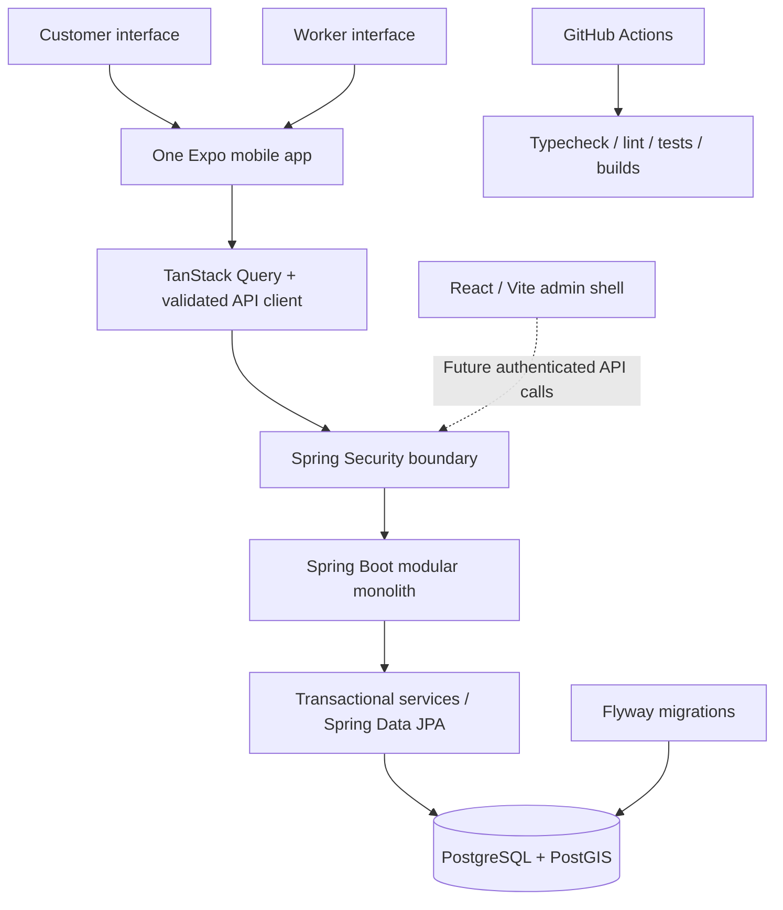

# Architecture

## Scope and boundaries

Use a modular monolith while the product is being validated. Separate applications have separate dependency lockfiles, build commands, and deployment boundaries within one Git repository. Shared contracts belong in versioned API documentation; do not couple TypeScript clients to Java entities.

Only the mobile health check currently calls the backend. Dashed connections are planned. The diagram describes the foundation and future connection points, not implemented marketplace workflows.

## Mobile

Expo SDK 57, React Native 0.86, strict TypeScript and Expo Router. Responsive shared components constrain wide layouts, preserve text scaling, support accessible buttons and use safe areas. NativeWind provides styling. TanStack Query owns remote state; Zustand holds a nonpersistent, initially empty session. Role predicates protect separate customer and worker route groups. A future authenticated role selector must use server-issued roles, never a self-granting client switch. Client guards do not replace server authorization.

React Hook Form and Zod resolver dependencies are ready for future forms. Zod currently validates API configuration and the health response. There is no fake registration or booking form. Error boundaries provide recovery; loading, empty and failure states are reusable. Native iOS work requires macOS later.

## Backend modules

- `security`: request authorization, no bootstrap accounts, method authorization.
- `booking`: booking entity, repository, state machine, internal transactional transition service.
- `shared`: safe RFC 9457 errors.
- `resources/db/migration`: authoritative schema and transaction safeguards.

User, worker, requirements and verification tables are designed now. Their application services and HTTP controllers will be added when approved. Package-by-feature expands within one application; do not create empty microservices.

No login provider exists. Default users, Basic login, role shortcuts and anonymous admin endpoints are absent. CSRF protection remains enabled. Only coarse health is public. OpenAPI generation is disabled by default and remains ADMIN-protected when enabled. Use test identities only in tests.

## Operational decisions

UTC instants in storage; display site-local times (initially Asia/Kolkata). PostGIS geography uses WGS84/SRID 4326. Production should use managed PostgreSQL with PostGIS support, managed application hosting and secret injection; provider selection and deployment are outside Phase 1. Local Compose binds ports to loopback. Use a privileged migration identity and a separate least-privilege runtime identity in production; the local Compose identity is development-only.

Do not store identity document scans, payment credentials, tokens in client bundles, or real customer information in fixtures. Verification records currently accept only synthetic review metadata.
