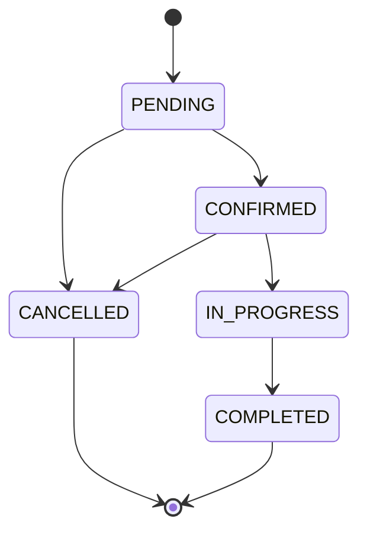

# Database design

The executable schema is `backend/src/main/resources/db/migration/V1__initial_schema.sql`; booking safeguards are in `V2__booking_invariants.sql`. Never edit an applied migration in a shared environment; add a new version.

| Table                    | Key and relationship                        | Purpose                                           |
| ------------------------ | ------------------------------------------- | ------------------------------------------------- |
| users                    | UUID PK; unique E.164 phone                 | Identity lifecycle; no password or document store |
| roles / user_roles       | role code; composite user + role PK         | Multiple roles per account                        |
| customer_profiles        | user FK/PK                                  | Customer type and optional organization           |
| worker_profiles          | user FK/PK                                  | Experience and biography                          |
| labour_categories        | UUID PK; unique code                        | Controlled skill taxonomy                         |
| worker_skills            | composite worker + category PK              | Many-to-many skills                               |
| worker_service_locations | UUID PK; worker FK                          | Region and optional geographic coverage           |
| worker_availability      | UUID PK; worker FK                          | Nonoverlapping available/unavailable intervals    |
| worker_teams             | UUID PK; owner FK                           | Team identity                                     |
| team_memberships         | composite team + worker PK                  | Team membership                                   |
| labour_requirements      | UUID PK; customer/category FKs              | Work scope, site, dates and headcount             |
| booking_requests         | UUID PK; requirement FK; worker XOR team FK | Request directed to one worker or team            |
| bookings                 | UUID PK; unique request FK                  | Fixed interval and lifecycle, optimistic version  |
| booking_workers          | composite booking + worker PK               | Individual assignment snapshot and reservations   |
| worker_verifications     | UUID PK; worker/reviewer FKs                | Synthetic review metadata only                    |

Every table records `created_at` and `updated_at`; triggers maintain updates. Foreign keys restrict deletion rather than cascading away booking history. Important FK, search, review-queue and status/time indexes are supplied. GiST indexes support spatial lookups, availability conflicts and booking exclusion. Phone strings are not numbers. Monetary rules are deliberately absent until pricing is decided.

## Booking transitions

Booking requests have separate states: PENDING → ACCEPTED / REJECTED / WITHDRAWN / EXPIRED. Request workflow endpoints are not implemented; those request transitions are a contract for the next phase. Confirmation requires an accepted request and at least one assigned worker. Bookings must begin pending. SQL and Java both enforce booking transitions; terminal bookings cannot reopen. Time and request identity are immutable; rescheduling means cancel and rebook. Cancellation after work begins needs a separate business-approved dispute/termination design.

## Double-booking safeguards

Intervals are half-open `[start,end)`, so one job may begin at the exact end of another. End must be later than start. `booking_workers` expands teams into individual workers. Assignment inserts require the requested worker or a member of the requested team. The roster becomes immutable after pending; later team membership edits do not rewrite booked worker history.

The service locks the booking row and flushes inside a transaction. Database triggers lock the parent for roster edits and derive worker reservation fields from the parent. Updating booking status synchronizes reservations atomically. A partial GiST exclusion constraint rejects overlapping reserved intervals for the same worker, including competing transactions and different teams. Cancelling releases reservations; completed bookings retain historical reservations. Direct attempts to clear `reserved` are overwritten by the trigger. Any conflict rolls back the entire confirmation and maps to HTTP 409 if exposed through a future controller.

Testcontainers tests cover overlap, adjacent intervals, cancellation, immutable rosters, derived-field tampering and concurrent confirmation. Local execution status is recorded in the phase report. Never infer successful migration from static SQL inspection.

## Remaining domain enforcement

Availability is declarative in Phase 1, not a prerequisite for confirmation. Future application services must enforce active accounts, profile/role consistency, verified skills, availability, request ownership, sufficient headcount, requirement dates, review authorization and customer cancellation policy. No booking HTTP endpoint is exposed until those checks exist. Add idempotency keys before accepting network retries for booking creation. Teams require a defined membership-consent policy. Real identity verification requires a separate privacy and retention design.

Phase 1 migrations seed three role codes; Phase 2 additionally seeds the initial trades and trade skills. Integration tests insert and remove synthetic people in a disposable database; no realistic identity documents or payments are used.

## Phase 2 authentication and onboarding (V4 → V5)

V1–V4 checksums are preserved (verification/phase2-migration-checksums-20260930.json). V4 introduces OTP challenges, refresh credentials, onboarding state and initial profile fields. V5 is a forward security/completeness correction; never rewrite applied migrations.

| Table/change | Enforced relationship or rule |
| --- | --- |
| otp_challenges | E.164 phone; attempts between zero and maximum; maximum 1–10; expiry after creation; updated timestamp trigger |
| auth_sessions | User FK; fixed expiry; revocation; unique session/user pair; user index; timestamps |
| refresh_tokens | Hash only, unique lookup; composite session/user FK; expiry check; session index; update trigger |
| onboarding_drafts | One per user; CUSTOMER/WORKER role; step 0–3; JSON object; timestamps and update trigger |
| customer_profiles | Nine customer types including OTHER; structured location JSON object |
| worker_profiles | Optional HTTPS photo URL validated by service; primary trade FK; availability enum; conditional team fields |
| trade_skills | Backend-managed skills; unique code and skill/trade pair; active flag and timestamps |
| worker_subskills | Composite FKs enforce skill belongs to trade and worker has that trade |

V4 refresh credentials are revoked during V5 migration; reauthentication is required. Existing profile values become resumable drafts. Earlier completion flags did not certify the new required fields, so existing CUSTOMER/WORKER accounts return to IN_PROGRESS step 0. No booking records are removed. The schema permits legacy TEAM rows with both team fields absent; the profile service requires them before new completion. Team onboarding metadata is not a team-membership workflow.

The service persists the full draft and step transactionally. Completion validates prior fields/review, saves profile/location/skill relationships, and marks the user COMPLETED. Phone advisory locks protect OTP issuance/verification; session row locks serialize refresh rotation and replay revocation. Refresh failures that revoke a family and incorrect OTP attempts commit their security state.

MigrationIT tests empty V1–V4 then V5, and upgrades a synthetic V3 database through V4/V5 while retaining its user. AuthenticationIT exercises real PostgreSQL persistence. FoundationIT retains booking overlap and repeated concurrent-confirmation checks. Current execution results, rather than schema presence, determine status in PHASE_2_REPORT.md.

## Phase 4 (V7–V9)

V7 adds quotations and quotation-originated bookings; V8 adds cancellation audit columns. V9 is a forward correction preserving V1–V8: one accepted quote per requirement, one booking per quote, positive amount/duration/note bounds, immutable finalized quote data and booking commercial terms, and complete/immutable cancellation audit values. Existing Phase 1 booking transitions and worker overlap exclusion remain active. Service cancellation is restricted to CONFIRMED bookings with a reason; the existing status trigger releases reservations.

Integration tests use disposable PostGIS databases. Cleanup truncates synthetic users and dependent tables without disabling triggers or session_replication_role. Unexpected SQL exceptions in concurrency tests are failures, not accepted losing outcomes. Before applying V9 to a non-disposable database, inspect any historical zero-price quotes, duplicate accepted quotes/bookings or incomplete cancellation audit values: constraints intentionally reject invalid legacy data instead of silently rewriting it.
